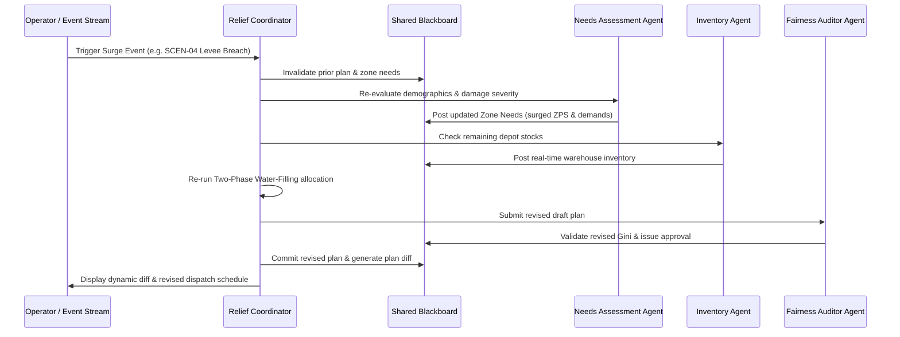

# ReliefOps AI — System Architecture & Multi-Agent Specifications

**Course:** CSE476 — Agentic AI and Intelligent Automation  
**Paradigm:** Synchronized Hayes-Roth Blackboard System  
**Framework:** Microsoft Semantic Kernel (Python) + ChromaDB Vector Storage

---

## 1. Architectural Overview & Design Philosophy

Emergency disaster relief operations require rapid, multi-faceted decision-making under conditions of high uncertainty, supply deficits, and infrastructure failure. Traditional monolithic software architectures or tightly-coupled peer-to-peer agent RPC pipelines break down when assumptions change or new constraints emerge.

To achieve maximum modularity, fault tolerance, and dynamic adaptability, **ReliefOps AI** implements the canonical **Hayes-Roth Blackboard Architecture**. In this paradigm:
1. **No direct agent-to-agent communication:** Agents do not invoke each other directly.
2. **Shared Blackboard Repository:** All problem state, environmental knowledge, intermediate calculations, and candidate decisions reside in a synchronized shared blackboard.
3. **Domain Specialists:** Five decoupled, autonomous agents monitor sections of the blackboard and contribute knowledge when their activation conditions are met.
4. **Distributive Fairness Gatekeeper:** Resource dispatches cannot be committed to disk or enacted until the **Fairness Auditor Agent** verifies that the candidate allocation satisfies humanitarian equity standards ($\text{Gini} \le 0.35$ and zero starvation).

```mermaid
graph TD
    subgraph SharedBlackboard ["Hayes-Roth Synchronized Shared Blackboard"]
        BB_DISASTER["/disaster_context<br/>Event ID, Hazard, Severity, Target Zones"]
        BB_SOP["/sop_context<br/>Governing SOPs, Ratios, Chunk Citations"]
        BB_NEEDS["/zone_needs<br/>Demands, ZPS Ranks, Vulnerability Factors"]
        BB_INV["/inventory_snapshot<br/>Warehouse Stock, Fleet Feasibility"]
        BB_LOG["/logistics_matrix<br/>Haversine Distances, Road Status, ETA"]
        BB_PLAN["/allocation_draft<br/>Itemized Dispatches, Two-Phase Water-Filling"]
        BB_AUDIT["/audit_verdict<br/>Gini Score, Survival Floor Check, Approval"]
    end

    RC["Relief Coordinator<br/>(Controller & Transaction Engine)"]
    NAA["Needs Assessment Agent<br/>(ChromaDB RAG & ZPS Scoring)"]
    IA["Inventory Agent<br/>(Warehouse Auditing & Stock Allocation)"]
    LA["Logistics Agent<br/>(Haversine Routing & Road Impairment)"]
    FAA["Fairness Auditor Agent<br/>(Distributive Justice Gatekeeper)"]

    RC -->|Write Context| BB_DISASTER
    NAA -->|Read| BB_DISASTER
    NAA -->|Write RAG & Needs| BB_SOP
    NAA -->|Write Rankings| BB_NEEDS

    IA -->|Read Needs| BB_NEEDS
    IA -->|Write Feasibility| BB_INV

    LA -->|Read Needs & Depots| BB_NEEDS
    LA -->|Write Transit Grid| BB_LOG

    RC -->|Execute Water-Filling| BB_PLAN
    FAA -->|Audit Candidate Plan| BB_PLAN
    FAA -->|Write Gate Verdict| BB_AUDIT
    RC -->|Enforce Decision & Persist| BB_AUDIT
```



---

## 2. The Five Specialized Autonomous Agents

### 1. Relief Coordinator (`backend/agents/relief_coordinator.py`)
- **Role:** Executive orchestrator, lifecycle supervisor, and transaction controller.
- **Responsibilities:**
  - Ingests user scenario parameters and initializes the blackboard.
  - Coordinates execution phases across the specialist agents.
  - Executes the **Two-Phase Water-Filling algorithm** to balance survival equity with priority scoring.
  - Supervises the **Fairness Auditor Gate**: if the candidate allocation is rejected, iterates with constraint relaxation or triggers human escalation.
  - Atomic persistence: inserts plan headers and itemized dispatches within a single atomic SQLite transaction (`BEGIN IMMEDIATE; COMMIT;`).
  - Generates the **Traceable AI Decision Audit Trail** (Phase 6 explainability).

### 2. Needs Assessment Agent (`backend/agents/needs_assessment_agent.py`)
- **Role:** Hazard analysis, RAG SOP retrieval, and demographic priority quantification.
- **Responsibilities:**
  - Queries **ChromaDB vector store** using semantic embeddings to retrieve hazard-specific Standard Operating Procedures (`SOP-FL-001`, `SOP-EQ-002`, `SOP-CY-004`, `SOP-LS-003`).
  - Extracts per-capita resource standards (drinking water, daily nutrition packs, family shelter tents, trauma kits).
  - Calculates the **Zone Priority Score ($ZPS_i$)** using hazard-specific weighting vectors:
    $$ZPS_i = 100 \cdot \left(\alpha \cdot \frac{D_i}{5} + \beta \cdot V_i + \gamma \cdot M_i + \delta \cdot A_i\right)$$
    where $D_i \in [1, 5]$ is damage severity, $V_i \in [0, 1]$ is demographic vulnerability, $M_i \in [0, 1]$ is medical urgency, and $A_i \in [0.1, 1.0]$ represents access difficulty.

### 3. Inventory Agent (`backend/agents/inventory_agent.py`)
- **Role:** Regional supply monitoring and inventory feasibility auditing.
- **Responsibilities:**
  - Queries SQLite regional warehouse inventories (`WH-GUWAHATI-NORTH`, `WH-JORHAT-EAST`, `WH-SILIGURI-WEST`, `WH-TEZPUR-CENTRAL`).
  - Aggregates available stock per resource category.
  - Performs feasibility checks: compares requested aggregate demand against depot capacity.
  - Flags resource deficits (`ADEQUATE`, `SHORTAGE`, `CRITICAL_SHORTAGE`) and logs stock depletion rates.

### 4. Logistics Agent (`backend/agents/logistics_agent.py` & `backend/plugins/logistics_plugin.py`)
- **Role:** Real-world road-network geospatial routing (OpenStreetMap/OSRM), Haversine fallback distance calculation, transit time estimation, and route accessibility modeling (upgraded in Phase 12).
- **Configurable Routing Modes (`ROUTING_MODE`):**
  1. **`ROAD_NETWORK`:** Queries an OpenStreetMap-compatible OSRM v1 endpoint (`OSRM_BASE_URL`, default `https://router.project-osrm.org`) for driving road distance, nominal free-flow duration, and GeoJSON polyline geometry (`route_geometry`), with in-memory coordinate caching and configurable timeouts (`ROUTING_TIMEOUT_SECONDS`).
  2. **`HAVERSINE_FALLBACK` (Default Offline Mode):** Computes great-circle geodesic distance scaled by terrain tortuosity ($W_t = 1.35$) using the **Haversine formula**:
     $$d = 2R \arcsin\left(\sqrt{\sin^2\left(\frac{\Delta \phi}{2}\right) + \cos(\phi_1)\cos(\phi_2)\sin^2\left(\frac{\Delta \lambda}{2}\right)}\right)$$
  - If `ROAD_NETWORK` times out, encounters HTTP/network errors, or returns no route, `LogisticsPlugin` automatically degrades to `HAVERSINE_FALLBACK` and records `fallback_used = True`, `fallback_reason`, and `routing_source`.
- **Road-Status Impedance (Field/Scenario Inputs — Not Live OSM Closures):**
  - `OPEN`: `1.0×` baseline travel speed (`45 km/h` Haversine fallback; `1.0×` OSRM nominal duration), `route_available = True`.
  - `DEGRADED`: `0.5×` speed (`22.5 km/h` Haversine fallback; `2.0×` OSRM nominal duration), `route_available = True`.
  - `BLOCKED`: `route_available = False`, `blocked_indicator = True`, `aerial_delivery_required = True`, heavily penalized ground transit multiplier (`0.15×`).
  - `AIR_ONLY`: Bypasses road network via direct aerial corridor (`90 km/h`, `aerial_delivery_required = True`).

### 5. Fairness Auditor Agent (`backend/agents/fairness_auditor_agent.py`)
- **Role:** Distributive justice validation and algorithmic gatekeeper.
- **Responsibilities:**
  - Computes the **Gini Coefficient** across all affected disaster sectors:
    $$G = \frac{\sum_{i=1}^n \sum_{j=1}^n |c_i - c_j|}{2n \sum_{i=1}^n c_i}$$
    where $c_i = \frac{\text{Allocated}_i}{\text{Demanded}_i}$ represents the aggregate need coverage ratio of zone $i$.
  - Enforces the **Humanitarian Gini Threshold**: $G \le 0.35$.
  - Enforces the **Zero-Starvation Floor**: rejects any candidate plan leaving an affected zone with $0\%$ allocation when supplies exist.
  - Categorizes verdict: `FAIRNESS_APPROVED`, `RESOURCE_ADEQUATE`, `APPROVED_WITH_SHORTAGES`, or `REJECTED`.

---

## 3. Mathematical Optimization: Two-Phase Water-Filling

Traditional disaster response often falls victim to **Naive Greedy Optimization**: dispatches prioritize zones with minimum transport distance to conserve fuel, leaving remote zones completely unserved.

ReliefOps AI prevents this humanitarian failure using **Two-Phase Water-Filling**:

```
                       TOTAL DEPOT INVENTORY (S)
                                  │
          ┌───────────────────────┴───────────────────────┐
          ▼                                               ▼
 PHASE 1: SURVIVAL FLOOR (30%)               PHASE 2: RESIDUAL WATER-FILLING
 Guarantees baseline survival rations        Distributes remaining 70% stock
 to EVERY sector regardless of distance:     weighted by Zone Priority Score:
   Alloc_1(i) = 0.30 * Demand(i)               Alloc_2(i) = S_residual * (ZPS_i / Σ ZPS)
```

### Empirical SCEN-05 Benchmark Comparison

| Metric | ReliefOps AI (Water-Filling) | Naive Greedy Optimization | Humanitarian Impact |
| :--- | :--- | :--- | :--- |
| **Gini Coefficient** | **0.0584** | **0.5679** | ReliefOps AI maintains high equity ($\le 0.35$) |
| **Minimum Zone Coverage** | **3.0%** (Water) / **100%** (Food) | **0.0%** (Peripheral zones starved) | Eliminates zero-allocation humanitarian failure |
| **Fairness Auditor Verdict** | `FAIRNESS_APPROVED` | `FAIRNESS_REJECTED (VETOED)` | Enforces automated ethical governance |
| **Peripheral Sector Protection** | Guaranteed survival floor | Completely deprived | Protects distant high-vulnerability populations |

---

## 4. Mid-Run Dynamic Re-Planning Engine

Disaster conditions are highly volatile. When secondary events occur (e.g., dam breach, secondary earthquake tremors), ReliefOps AI dynamically adapts without system restart:



---

## 5. Persistence, Concurrency & Security Architecture

### Collision-Free Plan Identifiers
Plan IDs incorporate sub-second timestamps and 8-character cryptographic random hex UUIDs:
$$\text{Plan ID} = \text{PLAN-YYYYMMDD-HHMMSS-}[A\text{--}F0\text{--}9]^8$$
This mathematically guarantees collision freedom under concurrent multi-threaded simulation and rapid dynamic replanning.

### Atomic Database Transactions
Database operations are managed via context managers enforcing SQLite `BEGIN IMMEDIATE TRANSACTION;`:
```python
with db.transaction() as cur:
    cur.execute("INSERT INTO allocation_plans ...")
    for item in dispatches:
        cur.execute("INSERT INTO allocation_items ...")
```
Any unexpected error triggers an automatic `ROLLBACK;`, preventing orphan dispatches.

### Hot Online Backups
Zero-data-loss snapshots are created via SQLite's native online backup API:
```python
def backup_database(self, backup_path: Path):
    with sqlite3.connect(self.db_path) as source:
        with sqlite3.connect(backup_path) as target:
            source.backup(target)
```

### Traceable AI Decision Audit Trail
Every allocation plan stores an immutable explainability payload:
- **Disaster Context & Governing SOP Document.**
- **Distributive Justice Justification:** Explicit explanation of Gini computation and fairness threshold adherence.
- **Per-Zone Prioritization Rationale:** Grounded in mathematical ZPS factors ($D_i, V_i, M_i, A_i$).
- **Resource Shortage Root-Cause Analysis:** Quantifying unmet demands and stock exhaustion reasons.
