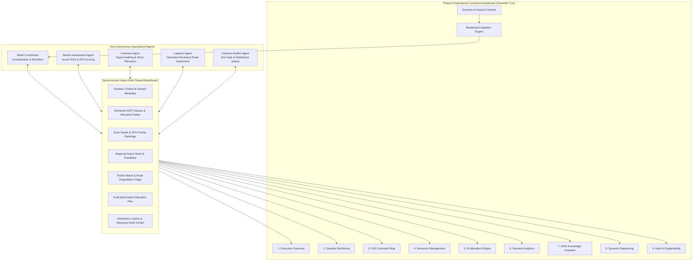

# ReliefOps AI — Autonomous Multi-Agent Disaster Relief Resource Allocation Platform

[](https://www.python.org/)
[](LICENSE)
[](tests/)
[](docs/SYSTEM_ARCHITECTURE.md)
[](PHASE12_ROUTING_IMPLEMENTATION_REPORT.md)

> **Academic Project Charter:** Developed exclusively for **CSE476 — Agentic AI and Intelligent Automation**.  
> **Topic:** Autonomous Multi-Agent Resource Allocation, RAG SOP Retrieval, Distributive Justice Auditing, Mid-Run Dynamic Re-Planning, and Emergency Operations Command Dashboard.

---

## 1. Executive Summary & Architecture Overview

Disaster relief logistics operate under severe epistemic uncertainty, damaged infrastructure, and intense supply scarcity. Conventional heuristic and cost-minimizing linear programming approaches suffer from a critical failure mode: **naive greedy optimization**. When regional depots minimize transit cost or Euclidean distance, peripheral and isolated communities with high vulnerability are starved of life-saving relief supplies.

**ReliefOps AI** addresses this challenge through a decoupled **Hayes-Roth Blackboard Architecture** orchestrating **five specialized autonomous agents** integrated with a dark-navy **Emergency Operations Center (EOC) Streamlit Command Dashboard** (`app.py`):



---

## 2. Phase 8 Operational Command Dashboard Modules (`app.py`)

The Streamlit Command Center provides **9 integrated operational modules** accessible via the unified 9-tab command deck or isolated via the **EOC Command Navigation** selector in the sidebar:

1. **Executive Overview:** Real-time mission command KPI cards (Total Affected Population, Displaced Population, Active Incident & SOP Reference, Total Resources Demanded, Total Resources Allocated, Critical Resource Shortages, Latest Allocation Plan ID, and Overall Fairness Gini Score), plus Sector Priority & Demand Matrix and ZPS Bar Chart.
2. **Disaster Monitoring:** Supports all 4 canonical hazards (`FLOOD`, `EARTHQUAKE`, `CYCLONE`, `LANDSLIDE`), hazard-specific SOP Section 2 severity scales, displacement metrics, zone-level damage/vulnerability/access telemetry, and governing SOP references (`SOP-FL-001`, `SOP-EQ-002`, `SOP-CY-004`, `SOP-LS-003`).
3. **GIS Command Map:** Interactive 2D/3D PyDeck geospatial command map built strictly from authentic database coordinates (`affected_zones` and `warehouses`), supporting **Phase 12 OpenStreetMap/OSRM `ROAD_NETWORK` routing** (`PathLayer` polylines, road distance, duration, blocked-corridor rings, and routing method metadata) with automatic **`HAVERSINE_FALLBACK`** (`ArcLayer` + `LineLayer`).
4. **Resource Management:** Independent tracking of `FOOD_RATIONS`, `CLEAN_WATER`, `MEDICAL_KITS`, and `SHELTER_TENTS` across Total Demanded, Total Available, Total Allocated, Fulfillment Percentage (capped at `100.0%`), Unfulfilled Shortage, and Surplus Inventory, alongside regional warehouse stock tables.
5. **AI Allocation Engine:** Synthesizes multi-depot shipment schedules via **Two-Phase Water-Filling** (Phase 1: 30% minimum survival floor; Phase 2: ZPS-proportional residual allocation), providing Zone-Wise Coverage tables, Warehouse-Wise Outbound Summaries, and CSV manifest export.
6. **Fairness Analytics:** Evaluates **Dimension A (Distributive Fairness, Gini $\le 0.35$)** independently from **Dimension B (Resource Adequacy)**, benchmarking ReliefOps AI against a **Naive Greedy Policy** with an interactive empirical **Lorenz Curve Comparison Chart**.
7. **RAG Knowledge Assistant:** Interactive disaster-response Q&A console connected directly to **ChromaDB** vector search (with automatic **Okapi BM25** fallback), returning grounded answers with `[SOP-ID | Chunk-ID]` citations and expandable verbatim SOP passages.
8. **Dynamic Replanning:** Interactive mid-run incident simulator (e.g., secondary levee breach, aftershock, slope failure) that invalidates stale Blackboard allocations, executes the full multi-agent replanning workflow while preserving the active hazard context, and renders a side-by-side Initial vs. Revised Plan Diff.
9. **Audit & Explainability:** Complete governance record featuring the Traceable AI Decision Audit Trail, Sector Prioritization Rationales, Resource Shortage Root Causes, SQLite Historical Plans Ledger (`allocation_plans`), and Synchronized Blackboard Event Journal (`blackboard_events`).

---

## 3. Supported Canonical Hazards & Scenarios

| Scenario ID | Canonical Hazard | Governing SOP | Evaluation Focus |
| :--- | :--- | :--- | :--- |
| **`SCEN-01`** | **FLOOD** | `SOP-FL-001` | Baseline 4-zone riverine flood response, RAG retrieval, and water-filling allocation |
| **`SCEN-02`** | **EARTHQUAKE** | `SOP-EQ-002` | High-magnitude seismic trauma response across 5 sectors under severe scarcity |
| **`SCEN-03`** | **CYCLONE** | `SOP-CY-004` | Severe tropical cyclone storm surge with washed-out bridge (`BLOCKED` access) |
| **`SCEN-04`** | **LANDSLIDE** | `SOP-LS-003` | Himalayan ridge slope failure and mid-run dynamic replanning (secondary surge) |
| **`SCEN-05`** | **BENCHMARK** | Hazard-Adaptive | Fairness Auditor veto & negotiation loop contrasting Water-Filling vs. Naive Greedy |

---

## 4. Installation & Startup Instructions

### Prerequisites & Configuration Requirements
- **Python:** Python `3.10+` (verified on Python `3.12.1`)
- **Database:** Built-in SQLite (`data/reliefops.db`) in `WAL` mode — no external database server required.
- **Vector Store:** Local persistent ChromaDB (`data/chromadb/`) using offline ONNX sentence embeddings (`all-MiniLM-L6-v2`) with automatic Okapi BM25 fallback — no external LLM API keys required for core deterministic execution.
- **Environment Configuration (Optional):** Copy `.env.example` to `.env` to customize `RELIEFOPS_DB_PATH`, `RELIEFOPS_CHROMA_DIR`, `RELIEFOPS_LOG_LEVEL`, or `RELIEFOPS_GINI_THRESHOLD` (default `0.35`).

### Step-by-Step Installation & Dashboard Startup

```bash
# 1. Navigate to project directory
cd reliefops_ai

# 2. Create and activate virtual environment
python -m venv .venv
# Windows PowerShell:
.\.venv\Scripts\activate
# Linux / macOS:
source .venv/bin/activate

# 3. Install pinned dependencies
pip install -r requirements.txt

# 4. Seed master SQLite database and index SOPs into ChromaDB
python -m backend.database.seeder

# 5. Launch the Phase 8 Operational Command Dashboard
streamlit run app.py
```

Once started, open **`http://localhost:8501`** in your browser.

### Terminal CLI Demonstration Startup

```bash
# Execute all 4 canonical hazards (SCEN-01..SCEN-04) and mid-run dynamic replanning
python demo_pipeline.py --all
```

### Docker Compose Startup (Phase 11 Verified)

```bash
# Build and launch ReliefOps AI in a non-root Linux container (preserves ./data/reliefops.db & ./data/chromadb)
docker compose up --build -d

# Verify healthcheck (expected: ok)
curl -f http://localhost:8501/_stcore/health
```

Open **`http://localhost:8501`** in your browser. See [DEPLOYMENT.md](DEPLOYMENT.md), [PHASE11_DEPLOYMENT_REPORT.md](PHASE11_DEPLOYMENT_REPORT.md), [PHASE11_TESTING_REPORT.md](PHASE11_TESTING_REPORT.md), and [DOCKER_TROUBLESHOOTING.md](DOCKER_TROUBLESHOOTING.md) for verified container benchmarks, persistence testing, and Windows Docker Desktop setup.

---

## 5. Automated Verification, Stress Benchmarks & Test Suite (`149` Tests)

```bash
# 1. Single-file & full-project Python bytecode compilation
python -m py_compile app.py
python -m compileall -q backend app.py demo_pipeline.py docker_entrypoint.py tests

# 2. Execute complete automated test suite (149 tests across Phases 1–12)
pytest -q

# 3. Execute Phase 12 Geospatial Routing (OSRM & Haversine Fallback) Suite
pytest -v tests/test_phase12_geospatial_routing.py

# 4. Execute Phase 9 End-to-End Integration & 500-Zone Stress Suite
pytest -v tests/test_phase9_end_to_end_validation.py

# 5. Execute Phase 8 Command Dashboard & Streamlit AppTest Suite
pytest -v tests/test_command_dashboard.py

# 6. Execute Phase 10 Dockerization & Non-Destructive Entrypoint Suite
pytest -v tests/test_phase10_deployment_dockerization.py
```

### Phase 9 Scalability Benchmarks (10 to 500 Disaster Zones)

| Disaster Zones | Routes Evaluated | Total Cycle p50 | Total Cycle p95 | Dashboard KPI+GIS p50 | Peak Memory | Error Rate |
| :---: | :---: | :---: | :---: | :---: | :---: | :---: |
| **10 Zones** | 40 | `1,051.46 ms` | `1,771.33 ms` | `8.09 ms` | `3.14 MB` | `0.0%` |
| **50 Zones** | 200 | `1,411.86 ms` | `1,432.87 ms` | `29.70 ms` | `1.92 MB` | `0.0%` |
| **100 Zones** | 400 | `1,865.92 ms` | `1,930.77 ms` | `58.02 ms` | `2.90 MB` | `0.0%` |
| **500 Zones** | 2,000 | `6,198.57 ms` | `6,290.20 ms` | `286.32 ms` | `13.29 MB` | `0.0%` |

See [docs/TESTING_AND_VALIDATION.md](docs/TESTING_AND_VALIDATION.md) for the complete Phase 9 verification report, failure recovery matrix, and subsystem latency profiles.

---

## 6. Known Limitations & Academic Deployment Readiness
1. **Synthetic Humanitarian Dataset:** All geographical coordinates (Assam/Brahmaputra basin), population counts, and warehouse inventories are deterministic synthetic models designed for academic evaluation in **CSE476 (Agentic AI and Intelligent Automation)**. Do not claim real-world emergency readiness based solely on academic simulation results.
2. **Great-Circle Routing Approximation:** The Logistics Agent computes Haversine great-circle distances scaled by a terrain tortuosity factor ($W_t = 1.35$) and road degradation multipliers rather than querying live commercial turn-by-turn traffic APIs.
3. **Deterministic Grounded RAG Synthesis:** The RAG Knowledge Assistant synthesizes grounded answers directly from top-ranked ChromaDB/BM25 SOP chunks to guarantee zero hallucination and 100% offline reproducibility without requiring paid external LLM API keys.
