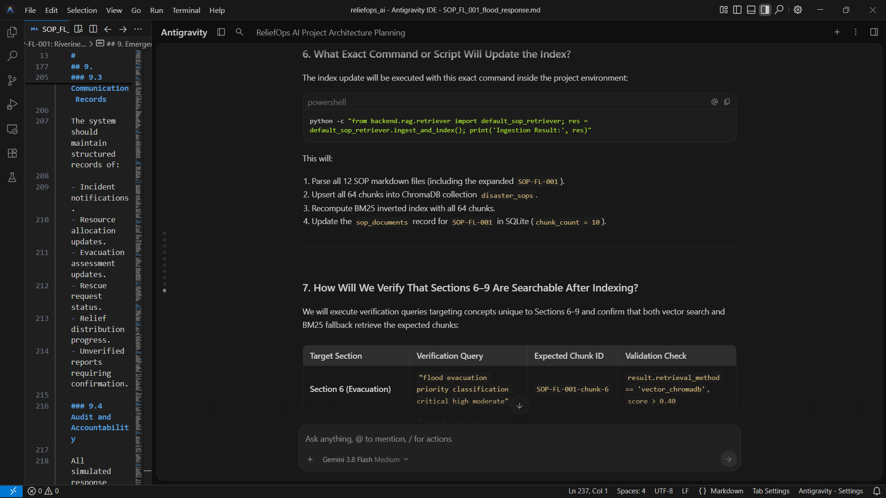

# SOP-FL-001: Riverine and Flash Flood Emergency Response Protocol

> **ACADEMIC DISCLAIMER**: This is a synthetic operational document generated solely for academic evaluation in CSE476 (Agentic AI and Intelligent Automation). Do not use for actual civil defense or disaster deployment.

## 1. Purpose and Operational Scope
This Standard Operating Procedure establishes standardized operational protocols for assessing disaster severity, computing urgent humanitarian resource demands, and executing logistical dispatch during sudden riverine flooding and monsoon flash-flood surges.

## 2. Severity Classification and Damage Scoring
Flood severity must be scored on a 5-point discrete ordinal scale:
- **Level 1 (Minor Inundation):** Standing water < 0.5m in agricultural periphery; road transit unobstructed.
- **Level 2 (Moderate Inundation):** Water depth 0.5m–1.0m; rural access roads degraded; residential ground floors flooded.
- **Level 3 (Severe Inundation):** Water depth 1.0m–2.0m; arterial roadways partially submerged; local drinking wells contaminated.
- **Level 4 (Critical Submersion):** Water depth > 2.0m; major transit bridges cut off; riverine islands isolated; boat/airdrop required.
- **Level 5 (Catastrophic Breach):** Embankment/dam breach; multi-village total submergence; immediate mass evacuation underway.

## 3. Minimum Humanitarian Relief Standards
Per-capita resource calculation norms for flooded zones:
- **Clean Drinking Water:** Minimum 15.0 liters per person per day (Sphere Water Supply Standard 2.1). In flood conditions where open water sources are pathogen-contaminated, prioritize sealed 10L jerrycans and chlorine purification tablets.
- **Survival Food Rations:** 2,100 kcal per person per day. One 3-day emergency family ration pack serves 5 individuals for 3 days (15 person-days per pack).
- **Emergency Medical Kits:** 1 Level-1 Trauma & Waterborne Disease kit per 250 affected individuals when medical urgency index $\ge 0.60$.
- **Emergency Shelter:** Weatherproof family tents allocated at 1 tent per displaced family (average 5 individuals per displaced household). Displacement ratio $= \min(1.0, DamageLevel \times 0.20)$.

## 4. Priority Weight Multipliers for Floods
When calculating the Zone Priority Score ($ZPS$), the Needs Assessment Agent must apply:
- **Damage Severity Weight ($w_d$):** 0.35
- **Demographic Vulnerability Weight ($w_v$):** 0.25 (amplify by $1.2\times$ if elderly/infant fraction $> 30\%$)
- **Medical Urgency Weight ($w_m$):** 0.25 (elevate for acute diarrhea/cholera outbreak reports)
- **Population Density Weight ($w_p$):** 0.15

## 5. Logistics Constraints and Road Impedance
- Corridors tagged `DEGRADED` due to standing water reduce heavy vehicle dispatch speed by 50% ($\eta_{road} = 0.50$).
- Corridors tagged `BLOCKED` (submerged highway $> 1.0m$) prohibit standard wheeled trucks ($\eta_{road} = 0.15$); flag immediately for amphibious transshipment or aerial deployment.
- High-priority zones must receive dispatch manifests within 12 hours of rapid onset.

## 6. Evacuation Priorities and Procedures

This section defines an academic decision-support framework for identifying evacuation priorities during simulated riverine and flash-flood emergencies.

### 6.1 Evacuation Priority Classification

Affected zones must be categorized according to the following illustrative priority levels:

- **Priority 1 (Critical):** Zones classified as Level 5 catastrophic flooding, including locations with reported embankment breaches or widespread submergence.
- **Priority 2 (High):** Zones classified as Level 4 critical submersion, particularly isolated settlements and locations with severely disrupted transportation access.
- **Priority 3 (Moderate):** Zones classified as Level 3 severe inundation, where residential areas and essential infrastructure are affected.
- **Priority 4 (Monitored):** Zones classified as Level 1 or Level 2, where conditions require continuous assessment and updated risk monitoring.

### 6.2 Evacuation Assessment Workflow

The Needs Assessment Agent must evaluate the following information in the academic simulation:

- Reported flood severity and affected geographical zones.
- Estimated population requiring evacuation.
- Number of elderly individuals, children, pregnant women, and persons with disabilities.
- Availability and accessibility of designated safe locations.
- Reported transportation and communication disruptions.

Evacuation recommendations must be associated with verified incident information and the appropriate authority's decisions.

### 6.3 Evacuation Decision Records

Each simulated evacuation assessment must maintain:

- Incident identification and affected zone.
- Recorded severity classification.
- Assigned evacuation priority.
- Estimated affected population.
- Identified accessibility requirements.
- Assessment timestamp and information source.

All evacuation decisions in the simulation are illustrative and must not be interpreted as actual deployment instructions.

---

## 7. Search and Rescue Coordination

This section describes a synthetic framework for representing search-and-rescue coordination and resource allocation within the ReliefOps AI knowledge base.

### 7.1 Rescue Priority Assessment

The Rescue Coordination Agent must consider:

- Reports of individuals requiring immediate assistance.
- Medical urgency and reported injuries.
- Number of people potentially isolated by floodwater.
- Presence of vulnerable individuals.
- Accessibility information and reported infrastructure damage.

### 7.2 Rescue Coordination Categories

Simulated rescue requests are categorized as follows:

- **Category A (Critical):** Verified reports of immediate threats to human life.
- **Category B (High):** Reports involving injured individuals or people isolated by flooding.
- **Category C (Moderate):** Reports involving individuals requiring assistance but without an established immediate life-threatening condition.
- **Category D (Assessment Required):** Incomplete or unverified rescue requests requiring additional information.

### 7.3 Rescue Resource Coordination

The system must maintain an academic representation of:

- Available rescue teams.
- Reported team availability and status.
- Medical assistance requirements.
- Transportation and accessibility constraints.
- Rescue request identification and priority.
- Resource assignment and completion status.

Only appropriately trained and authorized emergency responders should conduct actual rescue operations. Untrained individuals must not enter floodwater or attempt dangerous water rescues.

### 7.4 Rescue Activity Documentation

Every simulated rescue activity should maintain:

- Rescue request ID.
- Associated disaster incident ID.
- Affected zone.
- Assigned priority category.
- Reported assistance requirements.
- Assigned resource identifier.
- Activity status and timestamp.

---

## 8. Vulnerable Population Prioritization

This section establishes an academic framework for identifying additional assistance requirements among vulnerable population groups.

### 8.1 Vulnerability Identification

The Needs Assessment Agent must identify reported populations requiring additional assistance, including:

- Infants and young children.
- Elderly individuals.
- Persons with physical or cognitive disabilities.
- Pregnant and lactating women.
- Individuals with urgent medical requirements.
- Individuals without access to reliable transportation.

### 8.2 Vulnerability Assessment Factors

The following factors must be considered during simulated resource prioritization:

- Population vulnerability ratio.
- Medical urgency.
- Accessibility limitations.
- Availability of essential medicines.
- Drinking water and sanitation requirements.
- Access to temporary shelter.

### 8.3 Assistance Prioritization

The system should incorporate vulnerability information into the existing Zone Priority Score (ZPS).

Additional assistance requirements should be recorded separately to avoid overlooking populations whose needs may not be reflected by population size alone.

### 8.4 Accessibility and Inclusion

The academic allocation model should consider accessible transportation, suitable temporary accommodation, accessible communication, and continuity of essential medical support.

---

## 9. Emergency Response Coordination and Communication

This section establishes a synthetic information-management framework for coordinating simulated emergency response activities.

### 9.1 Incident Information Management

Each disaster incident must maintain:

- Unique incident identification.
- Disaster category and severity.
- Affected geographical zones.
- Incident reporting timestamp.
- Source of reported information.
- Current assessment status.

### 9.2 Inter-Agency Coordination

The simulation should represent coordination between the following organizational categories:

- State and district disaster management authorities.
- Emergency medical service organizations.
- Search-and-rescue organizations.
- Relief distribution and logistics teams.
- Temporary shelter management teams.
- Water, sanitation, and public health organizations.

These organizational categories are illustrative and do not establish actual agency assignments.

### 9.3 Emergency Communication Records

The system should maintain structured records of:

- Incident notifications.
- Resource allocation updates.
- Evacuation assessment updates.
- Rescue request status.
- Relief distribution progress.
- Unverified reports requiring confirmation.

### 9.4 Audit and Accountability

All simulated response activities must maintain traceable records containing:

- Event identification.
- Activity description.
- Associated SOP identification.
- Responsible system component.
- Timestamp.
- Previous and updated status.
- Source references.

### 9.5 Information Reliability

The system must distinguish between verified information, unverified reports, and system-generated recommendations.

When information is unavailable or uncertain, the system must explicitly indicate the limitation rather than generate unsupported operational instructions.

---

**ACADEMIC IMPLEMENTATION DISCLAIMER:** Sections 6–9 are synthetic educational additions created exclusively for the ReliefOps AI CSE476 academic project. They demonstrate knowledge representation, document retrieval, prioritization logic, and information coordination. They are not validated emergency-response procedures and must not be used for actual disaster management or rescue deployment.
