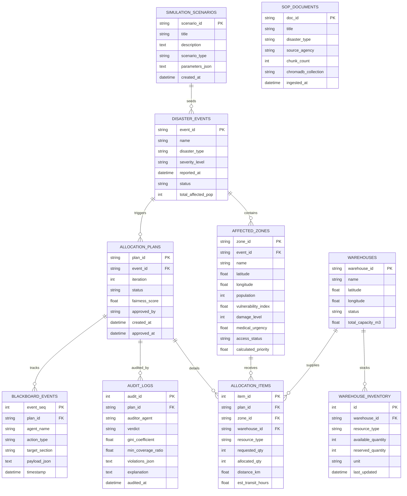

# ReliefOps AI — Database Schema & Data Architecture Specification
## SQLite Persistent Store & Blackboard State Persistence
**Document Version:** 1.0.0  
**Database Engine:** SQLite 3 (Standard Library `sqlite3`)  
**Storage Path:** `data/reliefops.db`  
**Workspace:** `C:\Users\deeps\.gemini\antigravity\scratch\reliefops_ai`

---

## 1. Overview & Architectural Role

While the in-memory **Blackboard** provides high-speed, volatile working memory for agent reasoning, **SQLite** acts as the authoritative, ACID-compliant persistence layer for:
1. Master reference data (geographical zones, coordinates, regional warehouses, baseline capacities).
2. Real-time warehouse inventory and transaction reservations.
3. Versioned disaster events and dynamically updated ground reports.
4. Historical allocation plans, itemized dispatch manifests, and audit decisions.
5. Append-only chronological blackboard event streams for transparent decision explainability.
6. Vector-linked SOP metadata and synthetic evaluation scenario configurations.

---

## 2. Entity-Relationship (ER) Diagram



---

## 3. Detailed Table Specifications & Data Dictionary

### 3.1 `disaster_events`
Stores disaster incident headers and broad casualty/population estimates.

| Column Name | Data Type | Constraints | Description |
| :--- | :--- | :--- | :--- |
| `event_id` | TEXT | PRIMARY KEY | Unique identifier (e.g., `EVT-2026-FL01`) |
| `name` | TEXT | NOT NULL | Human-readable title (e.g., "District Brahmaputra Flash Flood") |
| `disaster_type`| TEXT | NOT NULL | Type: `FLOOD`, `EARTHQUAKE`, `CYCLONE`, `LANDSLIDE` |
| `severity_level`| TEXT | NOT NULL | `MODERATE`, `SEVERE`, `CATASTROPHIC` |
| `reported_at` | DATETIME | NOT NULL | ISO 8601 timestamp of incident detection |
| `status` | TEXT | NOT NULL | `ACTIVE`, `RE-PLANNING`, `RESOLVED`, `ARCHIVED` |
| `total_affected_pop`| INTEGER | NOT NULL | Aggregated count of affected individuals across all zones |

### 3.2 `affected_zones`
Contains ground-truth and sensor assessments for each discrete geographic sector.

| Column Name | Data Type | Constraints | Description |
| :--- | :--- | :--- | :--- |
| `zone_id` | TEXT | PRIMARY KEY | Unique zone identifier (e.g., `ZONE-NORTH-A`) |
| `event_id` | TEXT | FOREIGN KEY -> `disaster_events` | Associated disaster incident |
| `name` | TEXT | NOT NULL | Geographical area label (e.g., "Riverside Sector 4") |
| `latitude` | REAL | NOT NULL | WGS84 Latitude coordinate |
| `longitude`| REAL | NOT NULL | WGS84 Longitude coordinate |
| `population`| INTEGER | NOT NULL | Total residing population in sector |
| `vulnerability_index`| REAL | NOT NULL | Demographic vulnerability score [0.0 - 1.0] (elderly, infants, poverty) |
| `damage_level`| INTEGER | NOT NULL | Infrastructure destruction scale [1 = Low, 5 = Total Collapse] |
| `medical_urgency`| REAL | NOT NULL | Trauma/disease criticality index [0.0 - 1.0] |
| `access_status`| TEXT | NOT NULL | `OPEN`, `DEGRADED`, `BLOCKED`, `AIR_ONLY` |
| `calculated_priority`| REAL | DEFAULT 0.0 | Normalized multi-attribute priority score derived by Needs Agent |

### 3.3 `warehouses`
Master data of regional supply depots and logistics fulfillment hubs.

| Column Name | Data Type | Constraints | Description |
| :--- | :--- | :--- | :--- |
| `warehouse_id` | TEXT | PRIMARY KEY | Unique depot code (e.g., `WH-CENTRAL-01`) |
| `name` | TEXT | NOT NULL | Depot name (e.g., "Regional Logistics Hub Alpha") |
| `latitude` | REAL | NOT NULL | Depot WGS84 Latitude |
| `longitude`| REAL | NOT NULL | Depot WGS84 Longitude |
| `status` | TEXT | NOT NULL | `OPERATIONAL`, `CAPACITY_WARNING`, `INACCESSIBLE` |
| `total_capacity_m3`| REAL | NOT NULL | Total volume capacity in cubic meters |

### 3.4 `warehouse_inventory`
Live stock keeping units (SKUs) available across regional warehouses.

| Column Name | Data Type | Constraints | Description |
| :--- | :--- | :--- | :--- |
| `id` | INTEGER | PRIMARY KEY AUTOINCREMENT | Surrogate primary key |
| `warehouse_id` | TEXT | FOREIGN KEY -> `warehouses` | Warehouse reference |
| `resource_type`| TEXT | NOT NULL | `FOOD_RATIONS`, `CLEAN_WATER`, `MEDICAL_KITS`, `SHELTER_TENTS` |
| `available_quantity`| INTEGER | NOT NULL, CHECK >= 0 | Immediately dispatchable unit count |
| `reserved_quantity` | INTEGER | DEFAULT 0, CHECK >= 0 | Units earmarked for in-flight allocation drafts |
| `unit` | TEXT | NOT NULL | Measurement unit (`packs`, `liters`, `kits`, `tents`) |
| `last_updated`| DATETIME | NOT NULL | Timestamp of last stock modification |

### 3.5 `allocation_plans`
Summary records of end-to-end allocation iterations generated by the multi-agent system.

| Column Name | Data Type | Constraints | Description |
| :--- | :--- | :--- | :--- |
| `plan_id` | TEXT | PRIMARY KEY | Unique allocation plan ID (e.g., `PLAN-202611-001`) |
| `event_id` | TEXT | FOREIGN KEY -> `disaster_events` | Associated incident |
| `iteration` | INTEGER | NOT NULL DEFAULT 1 | Iteration count (increments upon fairness revisions) |
| `status` | TEXT | NOT NULL | `DRAFT`, `AUDITING`, `REVISION_REQUIRED`, `APPROVED`, `RELEASED`, `REJECTED` |
| `fairness_score`| REAL | DEFAULT 0.0 | Calculated composite fairness metric (1.0 - Gini) |
| `approved_by`| TEXT | DEFAULT NULL | Authorizer: `AUTO_GATE_FAIRNESS_AGENT` or `HUMAN_COMMANDER` |
| `created_at` | DATETIME | NOT NULL | Plan synthesis timestamp |
| `approved_at`| DATETIME | DEFAULT NULL | Approval timestamp |

### 3.6 `allocation_items`
Disaggregated, itemized supply dispatches linking specific warehouses to destination zones.

| Column Name | Data Type | Constraints | Description |
| :--- | :--- | :--- | :--- |
| `item_id` | INTEGER | PRIMARY KEY AUTOINCREMENT | Unique item identifier |
| `plan_id` | TEXT | FOREIGN KEY -> `allocation_plans` | Associated parent plan |
| `zone_id` | TEXT | FOREIGN KEY -> `affected_zones` | Destination zone |
| `warehouse_id` | TEXT | FOREIGN KEY -> `warehouses` | Origin dispatch hub |
| `resource_type`| TEXT | NOT NULL | Categorical resource type |
| `requested_qty`| INTEGER | NOT NULL | Calculated demand quantity based on SOP norms |
| `allocated_qty`| INTEGER | NOT NULL | Actual units allocated by optimization algorithm |
| `distance_km` | REAL | NOT NULL | Route transit distance in kilometers |
| `est_transit_hours`| REAL | NOT NULL | Estimated transit duration accounting for road status |

### 3.7 `audit_logs`
Cryptographic-style audit records logged exclusively by the Fairness Auditor Agent.

| Column Name | Data Type | Constraints | Description |
| :--- | :--- | :--- | :--- |
| `audit_id` | INTEGER | PRIMARY KEY AUTOINCREMENT | Audit sequence ID |
| `plan_id` | TEXT | FOREIGN KEY -> `allocation_plans` | Evaluated allocation plan |
| `auditor_agent`| TEXT | NOT NULL | Identity string (`FairnessAuditorAgent-v1`) |
| `verdict` | TEXT | NOT NULL | `APPROVED`, `REJECTED`, `WARNING_OVERRIDDEN` |
| `gini_coefficient`| REAL | NOT NULL | Measured Gini coefficient across zone satisfaction |
| `min_coverage_ratio`| REAL | NOT NULL | Lowest satisfaction ratio observed across any zone |
| `violations_json` | TEXT | NOT NULL | Serialized JSON array of flagged violations |
| `explanation` | TEXT | NOT NULL | Natural language explanation justifying audit verdict |
| `audited_at` | DATETIME | NOT NULL | Audit timestamp |

### 3.8 `blackboard_events`
Append-only chronological journal capturing every agent interaction with the shared memory.

| Column Name | Data Type | Constraints | Description |
| :--- | :--- | :--- | :--- |
| `event_seq` | INTEGER | PRIMARY KEY AUTOINCREMENT | Global sequential event index |
| `plan_id` | TEXT | NOT NULL | Active plan reference |
| `agent_name` | TEXT | NOT NULL | Name of interacting agent |
| `action_type`| TEXT | NOT NULL | `READ`, `WRITE`, `POST_NEED`, `AUDIT_CHECK`, `INVALIDATE`, `COMMIT` |
| `target_section`| TEXT| NOT NULL | Blackboard slice modified (`disaster_context`, `inventory`, etc.) |
| `payload_json` | TEXT | NOT NULL | JSON snapshot of data posted or state altered |
| `timestamp` | DATETIME | NOT NULL | Microsecond-accurate timestamp |

### 3.9 `sop_documents`
Catalog of ingested standard operating procedures, manuals, and humanitarian guidelines.

| Column Name | Data Type | Constraints | Description |
| :--- | :--- | :--- | :--- |
| `doc_id` | TEXT | PRIMARY KEY | Document code (e.g., `SOP-SPHERE-WATER-01`) |
| `title` | TEXT | NOT NULL | Full document title |
| `disaster_type`| TEXT | NOT NULL | Relevant hazard category (`ALL`, `FLOOD`, `EARTHQUAKE`) |
| `source_agency`| TEXT | NOT NULL | Issuing authority (`Sphere Standards`, `NDMA`, `WHO`) |
| `chunk_count` | INTEGER | NOT NULL | Number of embedded vector chunks stored in ChromaDB |
| `chromadb_collection`| TEXT | NOT NULL | Name of target ChromaDB collection |
| `ingested_at`| DATETIME | NOT NULL | Ingestion timestamp |

### 3.10 `simulation_scenarios`
Configuration definitions for the 5 university evaluation scenarios and what-if simulations.

| Column Name | Data Type | Constraints | Description |
| :--- | :--- | :--- | :--- |
| `scenario_id` | TEXT | PRIMARY KEY | Scenario code (`SCEN-01` through `SCEN-05`) |
| `title` | TEXT | NOT NULL | Display name |
| `description`| TEXT | NOT NULL | Evaluation narrative and test objectives |
| `scenario_type`| TEXT | NOT NULL | `BASELINE`, `EXTREME_SCARCITY`, `LOGISTICS_FAILURE`, `DYNAMIC_REPLAN`, `AUDIT_REJECTION` |
| `parameters_json`| TEXT| NOT NULL | Seed configuration parameters (zones, supply multipliers, road blockages) |
| `created_at` | DATETIME | NOT NULL | Creation timestamp |

---

## 4. SQLite Pragmas, Concurrency & Transaction Management

To ensure high reliability, zero database locks during concurrent reads, and strict data consistency:

1. **Write-Ahead Logging (WAL Mode):**
   ```sql
   PRAGMA journal_mode = WAL;
   PRAGMA synchronous = NORMAL;
   ```
   Allows simultaneous reads from Streamlit UI while agents execute write transactions on the Blackboard.

2. **Foreign Key Enforcement:**
   ```sql
   PRAGMA foreign_keys = ON;
   ```
   Prevents orphan allocation items, missing warehouse foreign keys, or unlinked audit records.

3. **Atomic Stock Commitment:**
   Stock deduction operations are executed within explicit SQLite transactions:
   ```sql
   BEGIN IMMEDIATE TRANSACTION;
   -- 1. Deduct allocated quantities from available_quantity
   UPDATE warehouse_inventory 
   SET available_quantity = available_quantity - :allocated_qty,
       last_updated = CURRENT_TIMESTAMP
   WHERE warehouse_id = :warehouse_id AND resource_type = :resource_type
     AND available_quantity >= :allocated_qty;
     
   -- 2. Update allocation plan status to RELEASED
   UPDATE allocation_plans SET status = 'RELEASED' WHERE plan_id = :plan_id;
   COMMIT;
   ```
   If any warehouse lacks adequate unreserved quantity, the transaction rolls back automatically with zero partial writes.

---

## 5. Synthetic Master & Seed Data Specification

The database will be initialized with a comprehensive, realistic synthetic dataset representing an active disaster region (e.g., Eastern Delta / Brahmaputra Valley simulation):

- **4 Regional Warehouses:**
  - `WH-KOLKATA-CENTRAL` (Primary Mega-Depot: high capacity, deep water/food reserves)
  - `WH-GUWAHATI-NORTH` (Regional Hub: high medical/tent reserves, close to flood plains)
  - `WH-SILIGURI-WEST` (Forward Staging Depot: rapid road transit, moderate stocks)
  - `WH-JORHAT-EAST` (Auxiliary Depot: smaller buffer stock)

- **6 Affected Disaster Zones:**
  - `ZONE-MAJULI-ISLAND` (Pop: 45,000 | Vulnerability: 0.88 | Damage: 4/5 | Access: DEGRADED)
  - `ZONE-KAZIRANGA-RURAL` (Pop: 28,000 | Vulnerability: 0.75 | Damage: 3/5 | Access: OPEN)
  - `ZONE-DIBRUGARH-URBAN` (Pop: 110,000 | Vulnerability: 0.52 | Damage: 3/5 | Access: OPEN)
  - `ZONE-DHEMAJI-PERIPHERY` (Pop: 32,000 | Vulnerability: 0.92 | Damage: 5/5 | Access: BLOCKED)
  - `ZONE-NAGAON-CENTRAL` (Pop: 65,000 | Vulnerability: 0.60 | Damage: 2/5 | Access: OPEN)
  - `ZONE-BARPETA-SOUTH` (Pop: 52,000 | Vulnerability: 0.81 | Damage: 4/5 | Access: OPEN)

- **4 Standard Humanitarian Resource Categories:**
  1. `FOOD_RATIONS` (Individual 2,100 kcal survival ration packs)
  2. `CLEAN_WATER` (10-Liter Jerrycans / Potable water purification units)
  3. `MEDICAL_KITS` (Emergency trauma & basic medical care packs)
  4. `SHELTER_TENTS` (Family-sized weatherproof emergency shelter units)

