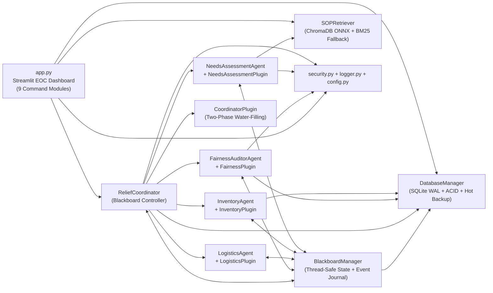

# ReliefOps AI — Phase 9 System Validation, Stress Benchmarks & Deployment Readiness

**Course:** CSE476 — Agentic AI and Intelligent Automation  
**Verified Test Baseline:** `133 / 133` Automated Tests Passing (`100%`)  
**Scope:** End-to-End Integration, 24-Query RAG Audit, Independent Fairness & Inventory Verification, Dynamic Replanning, SQLite ACID Integrity, 10–500 Zone Scalability Benchmarks, and Failure Recovery.

---

## 1. Component Dependency & Integration Map

---

## 2. Testing Methodology & Suite Breakdown (`133` Tests)

| Test Suite File | Tests | Validation Focus |
| :--- | :---: | :--- |
| `tests/test_phase9_end_to_end_validation.py` | **9** | Phase 9 full system audit: Scenarios A–G, 24 RAG queries across 4 hazards, independent Gini verification, 9-step replanning, FK/ACID DB integrity, 10–500 zone scalability, failure recovery & security |
| `tests/test_command_dashboard.py` | **8** | Phase 8 EOC Dashboard: all 9 modules, empty DB states, Lorenz curve math, GIS coordinates, RAG assistant, dynamic replanning, and Streamlit `AppTest` full-UI rendering |
| `tests/test_execution_integrity_telemetry.py` | **7** | Phase 7 hazard telemetry propagation, canonical scenario IDs, and inventory fulfillment cap ($\le 100\%$) |
| `tests/test_production_readiness.py` | **7** | Phase 6 secret masking, path traversal protection, UUID plan collision resistance, ACID rollback, hot backup/restore, structured logging, and explainability |
| `tests/test_stress_scenarios.py` | **13** | 12 deterministic synthetic stress scenarios across Flood, Earthquake, Cyclone, and Landslide |
| `tests/test_resource_constraints.py` | **10** | Adequate, partial, severe, zero-stock, and $10\times$ demand-over-supply conservation invariants |
| `tests/test_operational_resilience.py` | **7** | Mid-run dynamic replanning, invalid input recovery, idempotency, and memory stability |
| `tests/test_advanced_fairness_auditor.py` | **10** | Distributive justice gate ($\text{Gini} \le 0.35$), survival floor, and verdict engine |
| `tests/test_dashboard_stabilization.py` | **9** | Multi-zone shelter aggregation, water shortage reporting, and greedy baseline comparison |
| `tests/test_cross_hazard_consistency.py` | **6** | Cross-hazard SOP retrieval, severity equivalence, ZPS weights, and demand formulas |
| `tests/test_rag.py` | **7** | SOP markdown loading, chunking, ChromaDB vector indexing, citation accuracy, and BM25 fallback |
| `tests/test_database.py` & `test_blackboard_manager.py` & Phase 2–4 suites | **30** | Core agent, plugin, blackboard, and SQLite unit tests |

---

## 3. Empirical Stress & Scalability Benchmarks (10 to 500 Disaster Zones)

Controlled benchmarks were executed on isolated WAL-enabled SQLite instances across **10, 50, 100, and 500 synthetic disaster zones** and 4 regional depots (`2,000` warehouse-to-zone logistics corridors at 500 zones):

| Workload Scale | Total Cycle p50 (ms) | Total Cycle p95 (ms) | Total Cycle Max (ms) | Needs Agent p50 (ms) | Inventory Agent p50 (ms) | Logistics Agent p50 (ms) | Fairness Auditor p50 (ms) | Dashboard KPI + GIS p50 (ms) | Peak Traced Memory (MB) | CPU Time p50 (ms) | Error Rate |
| :--- | :---: | :---: | :---: | :---: | :---: | :---: | :---: | :---: | :---: | :---: | :---: |
| **10 Zones** (40 routes) | `1,051.46` | `1,771.33` | `1,771.33` | `476.13` | `6.62` | `10.47` | `19.15` | `8.09` | `3.14 MB` | `2,750.0` | **`0.0%`** |
| **50 Zones** (200 routes) | `1,411.86` | `1,432.87` | `1,432.87` | `537.75` | `9.85` | `37.53` | `62.47` | `29.70` | `1.92 MB` | `3,000.0` | **`0.0%`** |
| **100 Zones** (400 routes) | `1,865.92` | `1,930.77` | `1,930.77` | `612.45` | `12.00` | `69.43` | `135.05` | `58.02` | `2.90 MB` | `3,468.75` | **`0.0%`** |
| **500 Zones** (2,000 routes) | `6,198.57` | `6,290.20` | `6,290.20` | `1,224.43` | `42.57` | `425.64` | `634.60` | `286.32` | `13.29 MB` | `7,671.88` | **`0.0%`** |

### Subsystem Micro-Benchmarks
- **SQLite Read Query Latency (50 iterations):** `p50 = 0.09 ms`, `p95 = 0.20 ms`, `max = 0.44 ms`
- **ChromaDB ONNX Vector RAG Retrieval Latency (20 queries across 4 hazards):** `p50 = 454.96 ms`, `p95 = 485.42 ms`, `max = 515.67 ms`
- **Okapi BM25 Offline Fallback Latency:** `< 1.0 ms` (`0.08 ms – 0.45 ms`)

---

## 4. Failure Recovery & Security Controls

1. **ChromaDB Vector Store Unavailable:** Automatically degrades to `BM25Retriever` (`bm25_keyword_fallback`) with hazard-aware filtering over all 12 SOP documents.
2. **SQLite Interrupted Transaction Recovery:** `DatabaseManager.transaction()` wraps multi-table writes (`allocation_plans` + `allocation_items` and batched `affected_zones`) in `BEGIN IMMEDIATE ... COMMIT` blocks with automatic `ROLLBACK` on exception, plus online hot backup/restore (`backup_database()` / `restore_database()`).
3. **Referential Integrity & UPSERT Preservation:** `allocation_plans` status transitions use `ON CONFLICT(plan_id) DO UPDATE` rather than `INSERT OR REPLACE`, preventing `ON DELETE CASCADE` from removing historical `audit_logs`.
4. **Input Validation & XSS Hardening:** `backend/utils/security.py` validates zone coordinates, damage bounds (`1–5`), vulnerability/urgency (`0.0–1.0`), and file paths (`validate_path_safety`), while `app.py` applies `html.escape()` to untrusted strings rendered inside custom HTML KPI cards.
5. **Secret Masking:** `Settings.mask_secret()` redacts API keys (`sk-...mnop` or `<UNSET>`) across all configuration dumps and structured log entries.

---

## 5. Known Limitations & Deployment Readiness Assessment

- **Academic Simulation Scope:** All disaster scenarios, population distributions, and depot inventories are synthetic models developed for **CSE476 (Agentic AI and Intelligent Automation)**. Do not deploy for real-world life-safety dispatch without integrating live meteorological/seismic telemetry feeds and certified GIS road-network routing engines.
- **Deployment Readiness Verdict:** **READY FOR ACADEMIC DEMONSTRATION, TECHNICAL EVALUATION & GITHUB PUBLICATION** (`133/133` tests passing, zero syntax/compilation warnings, full offline reproducibility).
